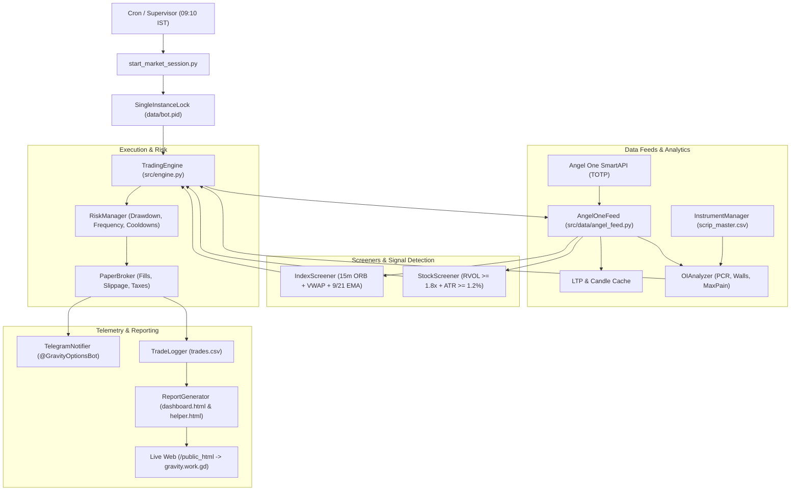
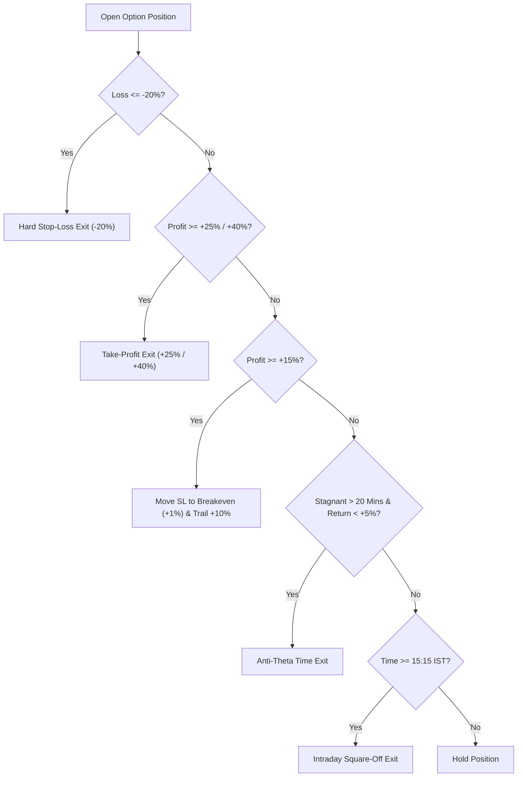

# 📘 GravityOptions - System Architecture, Strategy & Execution Playbook

This document details the complete end-to-end operation of **GravityOptions**: system architecture, universe selection, screening methodology, entry/exit rules, risk management protocols, and server operations.

---

## 📑 Table of Contents
1. [System Architecture & Core Components](#1-system-architecture--core-components)
2. [Market Timers & Daily Lifecycle](#2-market-timers--daily-lifecycle)
3. [Trading Universe & Scrip Selection](#3-trading-universe--scrip-selection)
4. [Strike Selection & Option Hub Analytics](#4-strike-selection--option-hub-analytics)
5. [Signal Generation & Entry Rules](#5-signal-generation--entry-rules)
6. [Position Sizing & Frequency Safeguards](#6-position-sizing--frequency-safeguards)
7. [Exit Rules & Trade Management](#7-exit-rules--trade-management)
8. [Statutory Taxes & Realistic Paper Broker](#8-statutory-taxes--realistic-paper-broker)
9. [Telegram Alerting Matrix](#9-telegram-alerting-matrix)
10. [Web Analytics & Reporting Engine](#10-web-analytics--reporting-engine)
11. [VPS Deployment & Operations Guide](#11-vps-deployment--operations-guide)

---

## 1. System Architecture & Core Components

GravityOptions is designed as a modular, event-driven algorithmic options buying engine for Indian equity derivatives (NSE/BSE).



### Core Modules
| Module | File | Purpose |
| :--- | :--- | :--- |
| **Trading Engine** | `src/engine.py` | Central coordinator; dispatches ticks, calls screeners, enforces risk checks, places trades. |
| **DhanHQ Feed** | `src/data/dhan_feed.py` | DhanHQ API connector with native `/v2/optionchain`, live Greeks (Delta, Theta, Gamma, IV), and 5m candles. |
| **Angel One Feed** | `src/data/angel_feed.py` | SmartAPI connector with auto-TOTP generation, rate-limiting (2.5 req/s), and real-time LTP/OI queries. |
| **OI Analyzer** | `src/data/oi_analyzer.py` | Calculates real-time Put-Call Ratio (PCR), Call Wall (Resistance), Put Wall (Support), and Max Pain. |
| **Instrument Manager** | `src/data/instrument_manager.py` | Resolves tokens from Angel One's instrument dump, identifies ATM/ITM/OTM strikes, and expiry dates. |
| **Index Screener** | `src/screener/index_screener.py` | Monitors NIFTY, BANKNIFTY, SENSEX, FINNIFTY for 15-minute Opening Range Breakouts with VWAP + EMA trend confirmation. |
| **Stock Screener** | `src/screener/stock_screener.py` | Evaluates 30 high-beta F&O stocks for Volume Surges (RVOL) and volatility expansion (ATR). |
| **Risk Manager** | `src/risk/risk_manager.py` | Enforces circuit breakers, position limits, cooldown periods, trailing stops, and anti-theta timeouts. |
| **Paper Broker** | `src/execution/paper_broker.py` | Simulates real fills with realistic slippage (0.5 pts) and all Indian taxes (STT, GST, Stamp Duty, Brokerage). |
| **Telegram Notifier** | `src/alerts/telegram_notifier.py` | Real-time HTML cards sent to Telegram for auth status, entries, exits, trailing SL, and daily summaries. |
| **Report Generator** | `src/reporting/report_generator.py` | Builds interactive HTML dashboards (`dashboard.html` & `helper.html`) published to `https://gravity.work.gd/`. |

---

## 2. Market Timers & Daily Lifecycle

Indian markets trade between **09:15 AM and 03:30 PM IST**. The system strictly adheres to the following schedule:

| Time (IST) | System Phase | Description |
| :--- | :--- | :--- |
| **09:10:00** | **Session Boot** | Cron triggers `start_market_session.py`. Acquires PID lock (`data/bot.pid`), connects to SmartAPI via TOTP, sends **Telegram Login Alert**, loads instrument master. |
| **09:15 - 09:30** | **Opening Range Formation** | 15-minute candle forms High & Low. No orders placed during this high-volatility discovery period. |
| **09:30 - 14:45** | **Active Trading Window** | Screeners active. Breakout signals evaluated every 5 seconds. Risk limits and stops monitored continuously. |
| **14:45:00** | **New Order Freeze** | No new trades permitted. Prevents opening trades in late-day decay. |
| **15:10:00** | **Stock Carry Evaluation** | Evaluates active stock positions for conditional overnight carry (BTST/Swing). Non-qualifying positions marked for exit. |
| **15:15:00** | **Intraday Square-Off** | All index options and intraday stock positions forcibly closed at market price to avoid overnight gap risk. |
| **15:15 - 15:40** | **"Casino Time" Avoidance** | System remains flat. Avoids late afternoon retail manipulation and gamma volatility. |
| **15:30:00** | **End of Day Reporting** | Dispatches EOD Telegram Summary card, updates trade log CSV, publishes final interactive HTML dashboard, terminates gracefully. |

---

## 3. Trading Universe & Scrip Selection

### A. Index Universe (High Liquidity)
- **NIFTY** (`NSE`): Strike interval: 50. Lot size: 25 / 75.
- **BANKNIFTY** (`NSE`): Strike interval: 100. Lot size: 15 / 30.
- **SENSEX** (`BSE` / `BFO`): Strike interval: 100. Lot size: 10 / 20.
- **FINNIFTY** (`NSE`): Strike interval: 50. Lot size: 25 / 65.

*Indices are toggleable via `config/config.yaml` (`enabled: true/false`).*

### B. High-Beta Stock Universe (Top 30 F&O Movers)
The bot tracks 30 liquid momentum names, including breakout runners identified by technical playbooks:
- **High Momentum / Trend Leaders:** `SUPREMEIND`, `BOSCHLTD`, `SOLARINDS`, `DIXON`, `POLYCAB`, `POLICYBZR`, `MCX`, `TRENT`, `BEL`, `HAL`.
- **Large-Cap Leaders:** `RELIANCE`, `TCS`, `INFY`, `HDFCBANK`, `ICICIBANK`, `SBIN`, `BHARTIARTL`, `LT`, `ITC`, `KOTAKBANK`, `AXISBANK`, `TATAMOTORS`, `TATASTEEL`, `MARUTI`, `SUNPHARMA`, `TITAN`, `BAJFINANCE`, `ADANIENT`, `ADANIPORTS`, `TVSMOTOR`.

### C. Stock Screening Criteria (RVOL & ATR Filters)
A stock is considered for trade **only** when both institutional criteria are met:
1. **Relative Volume (RVOL >= 1.8x):** Current volume must be at least 1.8 times the 20-period volume moving average.
2. **Volatility Expansion (ATR % >= 1.2%):** Current Average True Range must exceed 1.2% of the spot price, ensuring sufficient room for momentum before premium decay occurs.

---

## 4. Strike Selection & Option Hub Analytics

Rather than arbitrarily picking deep OTM contracts (which suffer high decay), the bot uses an institutional strike selection model:

### 1. Moneyness Preference
- Default: **Slight In-The-Money (ITM)** or **At-The-Money (ATM)**.
- Target Delta ($\Delta$): **0.50 – 0.65**.
- ITM/ATM contracts offer high intrinsic responsiveness and resist theta decay better than OTM strikes.

### 2. Option Hub & Institutional Order Flow Engine (MrChartist Model)
Inspired by institutional volume profiles and the 4-quadrant money flow model:
- **4-Quadrant Derivative Build-Up Matrix:**
  - **Long Build-Up ($\uparrow$ Price, $\uparrow$ OI):** Fresh aggressive institutional buying $\rightarrow$ **High Conviction CE**.
  - **Short Build-Up ($\downarrow$ Price, $\uparrow$ OI):** Institutions shorting / call writing $\rightarrow$ **High Conviction PE**.
  - **Short Covering ($\uparrow$ Price, $\downarrow$ OI):** Trapped bears covering shorts $\rightarrow$ Quick squeeze, prone to stall.
  - **Long Unwinding ($\downarrow$ Price, $\downarrow$ OI):** Bulls dumping losing longs $\rightarrow$ Fast liquidation, lacks aggressive sellers.
- **The 6-Pillar Conviction Meter (0 to 100 Score):**
  1. **PCR Sentiment (Max 25 pts):** Measures baseline put/call writer participation.
  2. **ATM Strike Writer Dynamics (Max 30 pts):** Evaluates if Call sellers are retreating (-OI) or defending (+OI) at ATM, and if Put sellers are loading support (+OI).
  3. **Build-Up Quadrant (Max 25 pts):** Validates underlying/strike build-up alignment.
  4. **Wall Resistance/Support Clearance (Max 20 pts):** Ensures trade isn't slamming right into a Call/Put Wall.
  5. **Dealer Gamma Exposure (GEX) Regime (-10 to +15 pts):** Evaluates whether dealers are in Negative Gamma (forced to hedge with momentum, accelerating breakouts) or Positive Gamma (absorbing moves, creating theta-burn chop).
  6. **NSE Participant Positioning / FII Bias (-10 to +15 pts):** Checks daily closing FII net index futures long % and net contract direction to align with smart money institutional tides.
  - *Hard Gate:* Trades require $\ge 55/100$ Conviction to execute; low conviction traps and choppy pinning regimes are blocked.

### 3. Dealer Gamma Exposure (GEX) & Gamma Flip (Option Hub Engine)
- **Net GEX Calculation:**
  $$\text{Call GEX} = +1 \times \Gamma_{\text{call}} \times \text{Call OI} \times \text{lot\_size} \times \frac{S^2 \times 0.01}{10^7}\quad (₹\text{ Cr per 1\% move})$$
  $$\text{Put GEX} = -1 \times \Gamma_{\text{put}} \times \text{Put OI} \times \text{lot\_size} \times \frac{S^2 \times 0.01}{10^7}\quad (₹\text{ Cr per 1\% move})$$
  $$\text{Total Net GEX} = \sum_{\text{strikes}} (\text{Call GEX} + \text{Put GEX})$$
- **Gamma Regimes:**
  - **Negative Gamma ($\text{Net GEX} < 0$):** Market makers are short gamma. Delta-hedging forces them to buy as price rises and sell as price drops, triggering explosive, trending breakout cascades (prime territory for options buyers).
  - **Positive Gamma ($\text{Net GEX} > 0$):** Market makers are long gamma. Hedging absorbs volatility by selling into rallies and buying into dips, causing price to mean-revert in tight chop (theta-decay trap).
- **Gamma Flip Level ($S_{\text{flip}}$):** The exact price level where net GEX crosses zero. Crossing above or below the flip marks an intraday volatility regime transition.

### 4. Daily NSE Participant Positioning Tracker (FII / DII / Pro / Retail)
- Sources daily `fao_participant_oi_DDMMYYYY.csv` from NSE archives after market close.
- **FII Index Futures Long %:**
  $$\text{FII Long \%} = \frac{\text{FII Fut Long}}{\text{FII Fut Long} + \text{FII Fut Short}} \times 100$$
  - $< 25\%$: Extreme FII short positioning $\rightarrow$ High potential for violent short-covering squeeze rallies.
  - $> 75\%$: Crowded FII long positioning $\rightarrow$ Prone to long unwinding drops.
- **FII Net Index Direction:**
  $$\text{Net Direction} = (\text{Fut Long} - \text{Fut Short}) + (\text{Call Long} - \text{Call Short}) - (\text{Put Long} - \text{Put Short})$$
- Provides a morning macro directional bias (`BULLISH`, `BEARISH`, `OVERSOLD_BOUNCE`, `NEUTRAL`) that informs the conviction score throughout the session.
- **Call Wall & Put Wall Checks:**
  - **Call Wall (Highest Call OI):** Major resistance. Long CE trades entering right below the Call Wall are blocked.
  - **Put Wall (Highest Put OI):** Major support. Long PE trades entering right above the Put Wall are blocked.

---

## 5. Signal Generation & Entry Rules

A trade is triggered when technical momentum and quantitative order flow align:

```
Entry Signal = 15m ORB Breakout + VWAP Confirmation + Dual EMA Trend + Order Flow Conviction (>= 55/100)
```

### Bullish Call Entry (CE)
1. **15m ORB:** Spot price crosses and closes above the 09:15–09:30 Opening High (with 0.05% buffer).
2. **VWAP Confirmation:** Current spot is **above VWAP** and VWAP slope is positive ($> +0.05\%$).
3. **EMA Alignment:** 9 EMA > 21 EMA on the 5-minute timeframe.
4. **Order Flow Gate:** Institutional Conviction Score $\ge 55/100$ (PCR $\ge 0.90$, ATM Call writers retreating or Put writers loading support, Long Build-Up / Short Covering).
5. **Cooldown Check:** No exit on this symbol within the last 15 minutes.

### Bearish Put Entry (PE)
1. **15m ORB:** Spot price crosses and closes below the 09:15–09:30 Opening Low (with 0.05% buffer).
2. **VWAP Confirmation:** Current spot is **below VWAP** and VWAP slope is negative ($< -0.05\%$).
3. **EMA Alignment:** 9 EMA < 21 EMA on the 5-minute timeframe.
4. **Order Flow Gate:** Institutional Conviction Score $\ge 55/100$ (PCR $\le 1.15$, ATM Put writers retreating or Call writers loading ceiling, Short Build-Up / Long Unwinding).
5. **Cooldown Check:** No exit on this symbol within the last 15 minutes.

---

## 6. Position Sizing & Frequency Safeguards

To prevent overtrading and revenge trading, strict portfolio caps are enforced by `RiskManager`:

| Risk Rule | Setting | Purpose |
| :--- | :--- | :--- |
| **Virtual Capital** | **₹2,00,000** | Active paper trading account capital for sizing and realistic simulation. |
| **Max Concurrent Positions** | **8 Positions** | Expanded from 3 to 8 to capture index and stock momentum opportunities simultaneously. |
| **Max Daily Trades** | **20 Trades / Day** | Expanded to collect rich statistical trading data across the full session. |
| **Max Trades per Symbol** | **3 Trades / Symbol** | Allows re-entry on valid second-leg trends while avoiding endless chop loops. |
| **Post-Trade Cooldown** | **15 Minutes** | Mandates a 15-minute wait after any position closes before re-evaluating the same symbol. |
| **Max Daily Loss Limit** | **₹15,000 (7.5%)** | Hard circuit breaker halting all new trades if daily drawdown is reached. |
| **Risk per Trade** | **1.5% (or Fixed 1 Lot)** | Limits maximum loss on any single trade to 1.5% of equity. |

---

## 7. Exit Rules & Trade Management

Options buying requires rapid loss cutting and active profit locking. The bot applies a 6-tier exit hierarchy:



### 1. Hard Initial Stop-Loss (-20%)
- Fixed stop-loss placed immediately at **-20%** of option entry price.
- If premium drops from ₹100 to ₹80, position is exited with no exceptions.

### 2. Profit Targets (+25% & +40%)
- **Target 1:** +25% ROI.
- **Target 2:** +40% ROI (or extended runner for high-momentum stock options).

### 3. Breakeven & Dynamic Trailing Stop-Loss
- **Breakeven Step:** Once profit reaches **+15%**, Stop-Loss automatically moves to **Breakeven (+1%)**, guaranteeing a risk-free trade.
- **Trailing Step:** For every further +10% gain, Stop-Loss trails upwards by +10% of premium, locking in accumulated profit during parabolic moves.

### 4. Anti-Theta Stagnation Rule (Time Stop)
- If an option position stays open for **20 minutes** without gaining at least **+5%**, the trade is closed.
- Prevents sideways chop from destroying premium via theta decay ($\Theta$).

### 5. Daily Risk Circuit Breaker
- If cumulative realized + unrealized daily loss reaches the hard cap (**-₹5,000**), the circuit breaker triggers:
  - All open positions are liquidated immediately.
  - Bot halts for the day.
  - Critical red alert dispatched to Telegram.

### 6. Intraday vs. Conditional Carry-Forward (BTST)
- **Index Options:** **100% Intraday**. Auto-closed at 15:15 IST.
- **Stock Options:** Eligible for overnight hold **only if**:
  1. Current unrealized profit $\ge 15\%$.
  2. Days to expiry $> 7$ days.
  3. Spot price is closing in the top 25% of the day's range.
  *If any condition is not met, the stock position is closed at 15:15 IST.*

---

## 8. Statutory Taxes & Realistic Paper Broker

Paper simulation calculates exact post-tax net P&L matching real Indian broker contract notes:

| Charge / Levy | Rate / Formula | Side Applicable |
| :--- | :--- | :--- |
| **Securities Transaction Tax (STT)** | 0.10% on Option Sell turnover | Sell Side Only |
| **Brokerage** | Flat ₹20 per executed order | Both Buy & Sell |
| **Exchange Turnover Fee** | 0.05% of trade turnover | Both Buy & Sell |
| **GST** | 18% on (Brokerage + Exchange Turnover Fee) | Both Buy & Sell |
| **SEBI Turnover Charges** | ₹10 per crore of turnover | Both Buy & Sell |
| **Stamp Duty** | 0.003% of purchase value | Buy Side Only |
| **Slippage Buffer** | 0.50 points modeled on fills | Both Entry & Exit |

---

## 9. Telegram Alerting Matrix

Telegram notifications are managed by `src/alerts/telegram_notifier.py` and configurable via `config/telegram_config.yaml`.

| Alert Type | Toggle Key | Sample Preview |
| :--- | :--- | :--- |
| **Broker Auth** | `login_success` | 🔐 **BROKER AUTHENTICATION SUCCESSFUL** 🟢<br>Client ID: `XYZ123` \| Connected & Session Active |
| **Signal Detected** | `signal_detected` | ⚡ **SIGNAL DETECTED** 🟢<br>NIFTY 24500 CE \| Spot: ₹24,480 \| PCR: 1.25 \| 15m ORB Breakout |
| **Order Entry** | `order_entry` | 🟢 **ORDER EXECUTED - BUY**<br>BANKNIFTY 51200 CE \| 1 Lot (15 Qty) @ ₹240.00 \| SL: ₹192.00 \| TP: ₹300.00 |
| **Trailing SL** | `trailing_sl_updated` | 🛡️ **TRAILING STOP-LOSS UPDATED**<br>Moved to Breakeven (+1%) @ ₹242.40 |
| **Order Exit** | `order_exit` | 🎉 **POSITION CLOSED** 🟢<br>Net P&L: **+₹1,850 (+25.7%)** \| Duration: 14m \| Charges: ₹58.40 |
| **Carry Decision** | `stock_carry_decision` | 🌙 **OVERNIGHT HOLD APPROVED** 🟢<br>SOLARINDS 20000 CE carried overnight (Profit: +32.4%) |
| **Circuit Breaker** | `risk_circuit_breaker` | 🚨 **RISK CIRCUIT BREAKER TRIGGERED** 🔴<br>Max daily loss reached (-₹5,000). All positions closed. |
| **Daily Summary** | `daily_summary` | 📊 **END-OF-DAY PERFORMANCE SUMMARY**<br>Win Rate: 75.0% (3W / 1L) \| Net P&L: **+₹4,230** |

---

## 10. Web Analytics & Reporting Engine

The bot generates and publishes real-time analytics to your web server:

- **Live URL:** `https://gravity.work.gd/`
- **Helper URL:** `https://gravity.work.gd/helper.html`
- **Dashboard Features:**
  - Dynamic KPI cards: Net P&L, Win Rate %, Profit Factor, Total Charges paid, Avg Win/Loss.
  - Interactive Equity Curve and P&L by Symbol breakdown (Chart.js).
  - Time filters: **Today (Daily)**, **Last 7 Days (Weekly)**, **Last 30 Days (Monthly)**, **All-Time**.
  - Searchable trade history table with entry/exit timestamps, execution reasons, and charge breakdowns.

---

## 11. VPS Deployment & Operations Guide

### Server Environment
- **Host:** `root@firehorse`
- **User:** `gravitywork`
- **App Path:** `/home/gravitywork/GravityOptions`
- **Python Venv:** `/home/gravitywork/GravityOptions/venv/bin/python`
- **Web Export Path:** `/home/gravitywork/public_html/index.html`

### Useful CLI Commands on VPS
```bash
# 1. Check live trading bot logs
tail -f /home/gravitywork/GravityOptions/trading.log

# 2. Check if bot is running (PID lock check)
pgrep -af run_paper_trading.py
cat /home/gravitywork/GravityOptions/data/bot.pid

# 3. Pull latest updates from Git
cd /home/gravitywork/GravityOptions
git stash
git pull origin main
git stash pop
chown -R gravitywork:gravitywork /home/gravitywork/GravityOptions

# 4. Manually trigger market session / web page generator
su -s /bin/bash gravitywork -c "/home/gravitywork/GravityOptions/venv/bin/python /home/gravitywork/GravityOptions/start_market_session.py"
```

---
*Document Version: 1.0.0 — Updated: November 2026*
